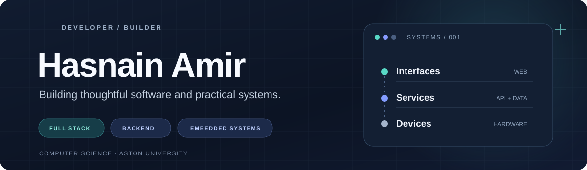

**Computer Science student at Aston University** · Full-stack development · Backend systems · Embedded software

I build useful, considered software, from web interfaces and backend services to databases and physical computing projects.

[**Portfolio ↗**](https://hasnainamir.com) &nbsp;·&nbsp; [**Email ↗**](mailto:hello@hasnainamir.com)

---

### Selected work

| Project | Overview | Explore |
| :--- | :--- | :--- |
| **CV Management System** | A Node.js, Express and MySQL application with account authentication, CV editing and live search. The public frontend repository is a **static showcase** of the interface. | [Backend](https://github.com/hasnain-amir/cv-management-backend) · [Frontend demo](https://github.com/hasnain-amir/cv-management-frontend) |
| **Project Management Database** | A third-normal-form MySQL schema modelling clients, projects, staff, skills and assignment queries. | [Repository ↗](https://github.com/hasnain-amir/project-management-database) |
| **Arduino Embedded Systems** | A Grove-kit group project exploring sensors, state-based control and real-world outputs. My contribution was the pedestrian-crossing state machine. | [Repository ↗](https://github.com/hasnain-amir/arduino-embedded-systems) |
| **Personal Portfolio** | A design-led personal website being built with Next.js, React, TypeScript and Tailwind CSS. **In development.** | [Repository ↗](https://github.com/hasnain-amir/hasnain-portfolio) |

### Tools & technologies

**Languages & web**

**Frameworks, platforms & hardware**

### What I'm working on

- Building and refining full-stack applications with attention to usability and maintainability.
- Developing backend architecture, authentication and relational data modelling skills.
- Exploring the intersection of software, physical devices and design.

---

  Interested in the work? <a href="https://hasnainamir.com">Visit my portfolio</a> or <a href="mailto:hello@hasnainamir.com">get in touch</a>.

